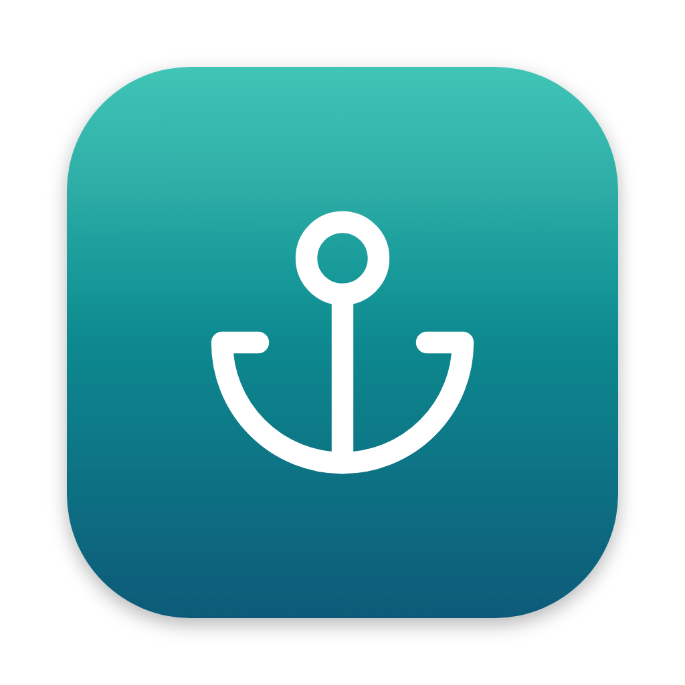
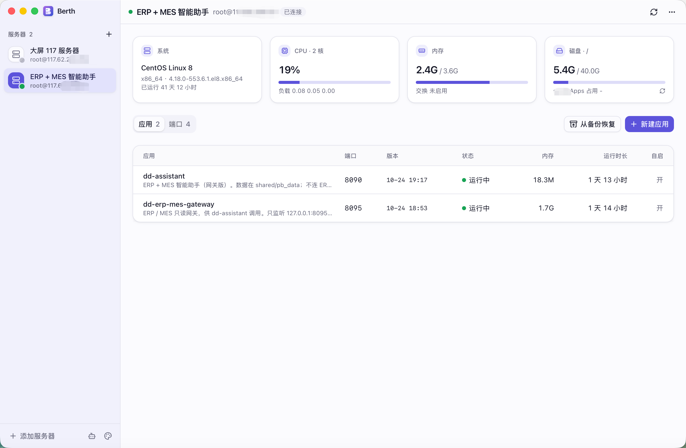
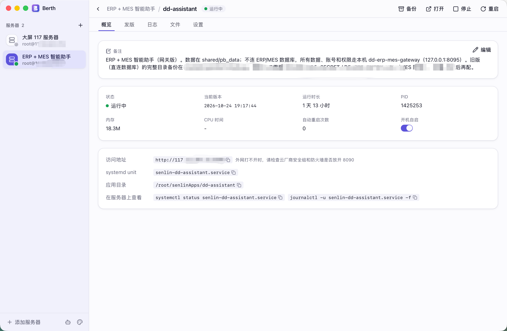
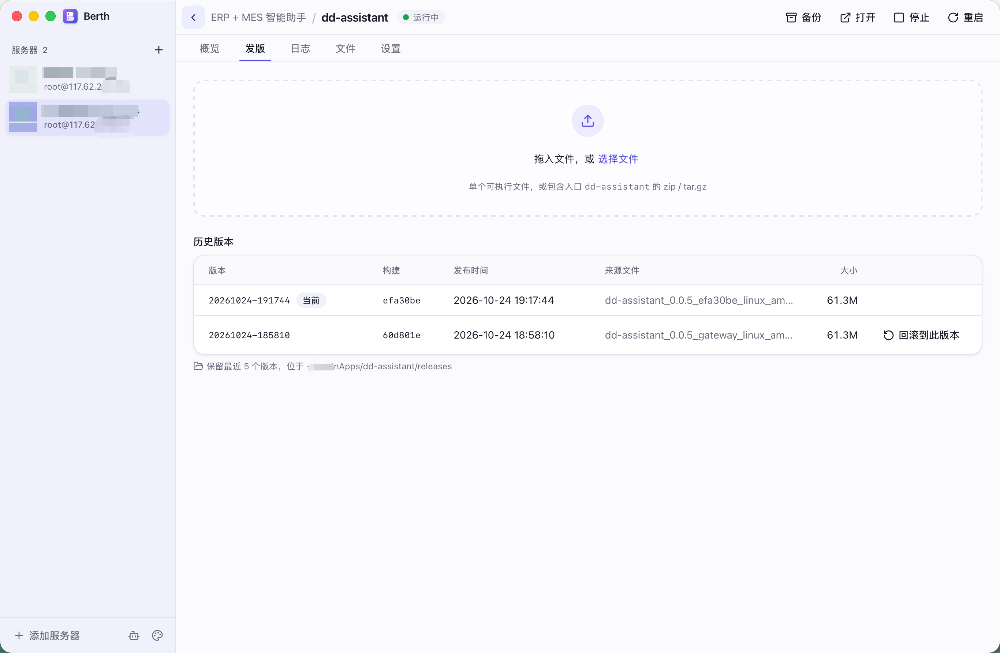
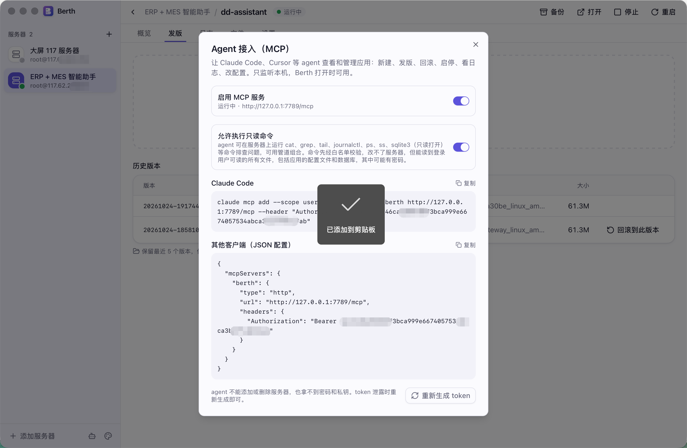

# Berth

本地桌面软件：通过 SSH 把任意 Linux 二进制部署到服务器，用服务器自带的 systemd 运行。服务器上不安装任何常驻程序。设计见 [berth-plan.md](berth-plan.md)。

## 界面

服务器上的应用、端口和资源占用。



单个应用的状态、访问地址和 systemd 单元。



拖入新的二进制发版，或回滚到历史版本。



侧栏里启用本机 MCP，把查看、发版和只读排查交给 agent。



## 开发

需要 Go 1.27+、Node.js 22+、pnpm 和 [Task](https://taskfile.dev)。

```sh
task dev        # 启动 Vite 和应用，改动后自动重载
task build      # 打包 macOS（universal）、Windows、Linux 三个平台到 dist/<os>-<arch>/
task            # 列出全部任务：test、e2e、check、icon、build:mac 等
```

图标源文件是 `design/icon.svg`（Windows 用去掉边距的 `design/icon-windows.svg`），修改后执行 `task icon` 重新生成同名 PNG。

## 发布签名安装包

`task build` 的 macOS 包是 ad-hoc 签名，只能在打包的这台 Mac 上运行；Windows 只有 `Berth.exe`。要分发给别人用 `task release`：

1. 在 Apple 开发者后台创建 **Developer ID Application** 证书并装进钥匙串（Apple Development / Apple Distribution 证书过不了 Gatekeeper）。
2. `task release:setup` 把公证凭据存进钥匙串（Apple ID + App 专用密码，配置名 `berth-notary`）。
3. `brew install makensis` 用于制作 Windows 安装程序；有 Windows 代码签名证书时再 `brew install osslsigncode`。
4. 复制 `.env.release.example` 为 `.env.release` 并填写，然后执行 `task release`。

产物：`dist/darwin-universal/` 中签名并公证的 `.app` 和 `.dmg`，`dist/windows-amd64/` 中的安装程序 `Berth Setup <版本>.exe`（配置了证书时会签名），`dist/linux-amd64/` 中的 `.deb`、`.tar.gz` 和 `install.sh`。

`mygo dev` 会根据 `services/` 中的 Go 代码重新生成 `frontend/src/mygo.ts`，也可以手动执行 `go tool mygo generate`。

| 目录 | 内容 |
|---|---|
| `core/` | 不依赖桌面框架的逻辑：`ssh`、`server`、`app`、`deploy`、`logs`、`config` |
| `services/` | MyGo 绑定层，只做转发和流式推送 |
| `frontend/` | React + Tailwind + shadcn/ui |
| `testdata/e2e/` | 端到端测试用的 Linux 服务器镜像和测试程序 |
| `design/` | 应用图标源文件与渲染脚本 |
| `screenshots/` | 界面截图，README 中引用 |

Agent 接入：侧栏底部的机器人图标里启用 MCP 服务，复制 `claude mcp add …` 命令即可。服务跑在应用进程内，只监听 `127.0.0.1:7789/mcp`（端口可在 config.json 的 `mcp.port` 修改），Berth 打开时可用。工具定义在 `services/mcp_tools.go`。同一处可打开「允许执行只读命令」，agent 便能用 `run_command` 在服务器上跑 cat、grep、tail、journalctl、sqlite3（自动加 `-readonly -safe`）等命令排查问题：命令按 POSIX sh 解析，只放行白名单里不能改动服务器的程序和参数（`core/readonly`），在服务器上以登录用户身份、nice 和超时运行，输出截断在 64 KiB。

环境变量 `BERTH_CONFIG` 可指定 config.json 的位置（默认在系统用户配置目录的 `Berth/` 下）。

## 测试

```sh
go test ./...                                   # 单元测试
BERTH_KEYRING_TEST=1 go test ./core/config      # 使用真实的系统钥匙串

# 端到端：一个运行 systemd + sshd 的容器，覆盖 root 和普通用户 deploy 两种模式
task e2e                                        # 构建并启动容器后运行，task e2e:stop 删除容器
```

调试构建可以从外部驱动窗口（执行 JS、截图、预设文件选择结果），不会进入正式包：

```sh
pnpm --dir frontend dev &
BERTH_CONFIG=/tmp/berth/config.json BERTH_MEMORY_SECRETS=1 \
  MYGO_DEV_URL=http://localhost:5173 go run -tags berthdebug .
curl -X POST --data 'return document.title' 127.0.0.1:7788/eval
curl 127.0.0.1:7788/capture -o shot.png
```
